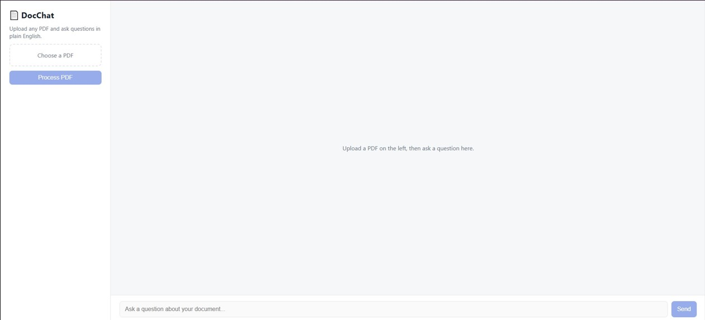

# RAG-Based Chatbot

A document-based conversational AI application that enables users to interact with PDF documents through natural language queries. Built using Retrieval-Augmented Generation (RAG), the application provides context-aware responses grounded in the content of uploaded documents.

## Application Preview



## Features

- PDF document upload and processing
- Context aware question answering
- Semantic document retrieval
- Source based responses
- Interactive conversational interface
- Docker based application deployment

## Technologies Used

| Category | Technologies |
|---|---|
| Programming Language | Python |
| Backend | FastAPI |
| Frontend | Frontend application |
| RAG Framework | LangChain |
| Embedding Model | Sentence Transformers (`all-MiniLM-L6-v2`) |
| Vector Database | FAISS |
| LLM Integration | Groq / Google Gemini |
| Document Processing | PyPDF |
| Containerization | Docker, Docker Compose |

## Installation & Setup

### Clone the Repository

```bash
git clone https://github.com/NoorFatima-14/RAG-Based_Chatbot.git
cd RAG-Based_Chatbot
```

### Configure Environment Variables

Create a `.env` file and add the required API key(s):

```env
GROQ_API_KEY=your_api_key
GOOGLE_API_KEY=your_api_key
```

### Run with Docker

```bash
docker compose up --build
```

Access the application at the local URL configured in your Docker Compose file.

## Author

**Noor Fatima**

[GitHub Profile](https://github.com/NoorFatima-14)
